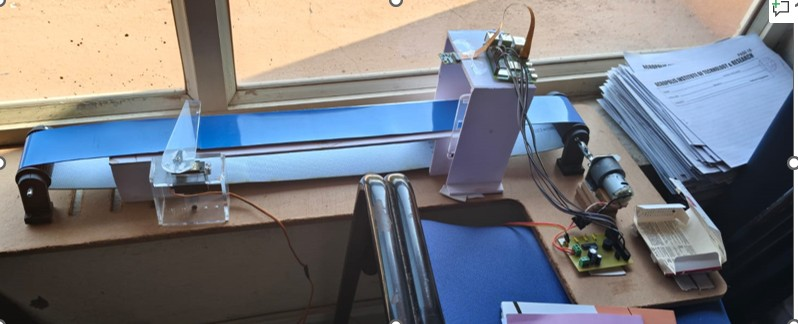
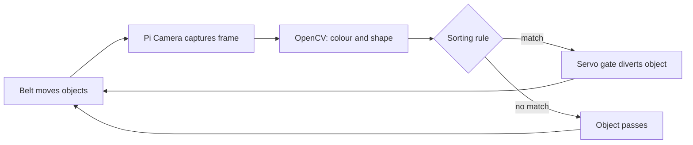
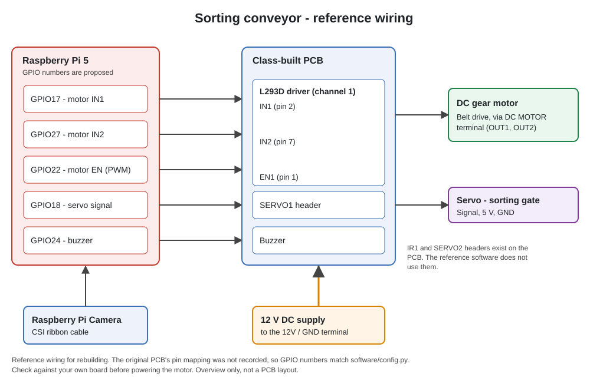

# Colour & Shape Sorting Conveyor (Raspberry Pi 5)

A conveyor belt that uses a Raspberry Pi 5 and a Pi Camera to identify the colour and shape of objects with OpenCV, and a servo gate to divert them into the right bin. Built collectively by the whole class during the Summer Industrial Training at Acropolis Institute of Technology & Research, Indore (Jul - Dec 2025).



## About this repository

The original code, circuit files and photos from the training were lost. What survived is the project report and a few photos. So this repository is a rebuild, and it is important to be clear about what is what:

| Part | Status |
|---|---|
| Machine, PCB and wiring (photos and report) | **Original project**, built by the whole class |
| `docs/working-principle.md` | Adapted from the original report |
| `software/` | **Rebuilt reference implementation. It is not the original code.** The vision logic is tested on synthetic images only; the full sorter has not been run on the original machine |
| GPIO pin numbers in `software/config.py` and the wiring diagram | **Proposed mapping.** The original PCB's pin mapping was not recorded |

### My part in the original project
This was a class project, so the machine, the PCB and the code were built by many people together. My part was hardware assembly and wiring, and setting up the camera and the belt.

## How it works



1. A DC motor, driven through an L293D on the class-built PCB, moves objects along the belt.
2. The Pi Camera looks at the belt. Anything that is not belt-coloured is treated as an object.
3. The object's colour is found from its HSV values, and its shape from contour approximation (circle, square, rectangle, triangle).
4. A rule in `config.py` decides whether the object is diverted. By default red objects are diverted and everything else passes.
5. After a travel delay the servo gate swings to divert the object, then returns to the pass position.

More detail: [`docs/working-principle.md`](docs/working-principle.md)

## Hardware

Raspberry Pi 5, Raspberry Pi Camera, a class-built PCB (L293D motor driver, servo header, buzzer, 12 V input), a DC gear motor, one servo for the gate, and a 12 V supply.



- [Bill of materials](hardware/bom.md)
- [Pin map and how to record your own](hardware/pin-map.md)
- [PCB notes](hardware/pcb-notes.md)

| PCB layout | Assembled PCB |
|---|---|
|  |  |

## Software

| File | Purpose |
|---|---|
| `software/sorter.py` | Main loop: capture, classify, schedule the gate |
| `software/vision.py` | Colour and shape detection (OpenCV) |
| `software/config.py` | Pins, colour ranges, rules and timings |
| `software/calibrate_hsv.py` | Slider tool to tune HSV ranges |
| `software/test_hardware.py` | Check motor, servo and buzzer before running |
| `software/tests/` | Tests on synthetic images |

### Run it

On Raspberry Pi OS (Bookworm):

```bash
sudo apt install python3-picamera2 python3-opencv
python3 -m venv --system-site-packages .venv
source .venv/bin/activate
pip install gpiozero lgpio

cd software
# 1. edit config.py so the pins match your wiring
python test_hardware.py     # motor, gate and buzzer check
python calibrate_hsv.py     # tune colours for your lighting (see docs/calibration.md)
python sorter.py            # run the sorter, Ctrl+C to stop
```

Run the tests on any computer with `pip install numpy opencv-python pytest` and `python -m pytest tests` inside `software/`.

Raspberry Pi 5 does not support the older `RPi.GPIO` library, so the code uses `gpiozero`. Calibration steps: [`docs/calibration.md`](docs/calibration.md).

## Limitations

- Pin numbers and tuned colour values from the original are not recorded, so the first run needs calibration.
- Timing based: the gate acts after a fixed delay, so belt speed changes the result.
- The belt is blue, so blue objects cannot be told apart from the belt.
- Lighting strongly affects colour readings.

## Ideas for next steps

- Add the IR sensor header on the PCB to trigger capture
- Add a second servo (the PCB has a `SERVO2` header) for a third bin
- Count and log sorted objects to a file
- Train a small classifier for objects that colour alone cannot separate

## License

[MIT](LICENSE)
