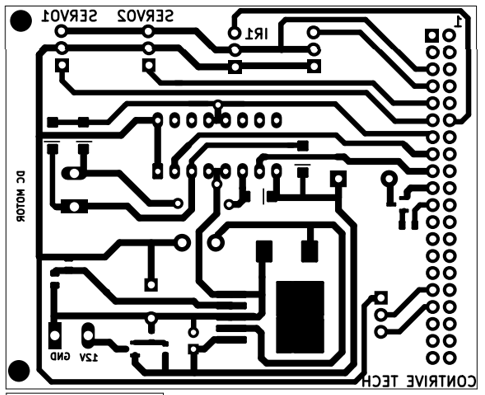
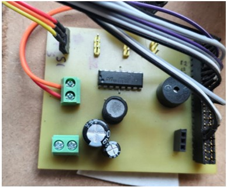

# PCB notes

*PCB layout from the project report (text is mirrored).*

*The assembled board.*

## What can be seen

- **Layout labels:** `SERVO1`, `SERVO2`, `IR1`, `DC MOTOR`, `12V` and `GND`, plus a 40-pin header column that connects to the Raspberry Pi GPIO.
- **Assembled board:** two green 2-pin screw terminals, a 16-pin DIP driver IC, three electrolytic capacitors, a buzzer, and header pins for the servo and the Pi connection.
- **Role:** the board takes the Raspberry Pi GPIO signals and drives the DC belt motor, the sorting-gate servo and a buzzer. The Pi itself does the image processing.

## Credits

The PCB was designed collectively by the class during the Summer Industrial Training. The layout carries the text "CONTRIVE TECH".
The layout files were not kept, so only the images above remain.
